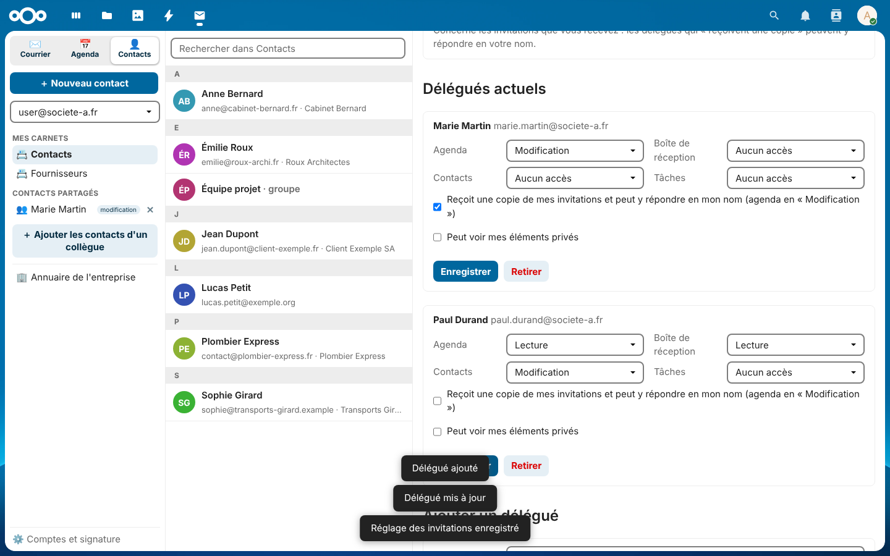

# Webmail Exchange pour Nextcloud

Application Nextcloud qui affiche le **courrier, l'agenda et les contacts** des boîtes **OVH Hosted Exchange**
directement dans Nextcloud.
Elle passe par **Exchange Web Services (EWS)**, l'API native d'Exchange, et non par IMAP/SMTP.

- Plusieurs serveurs Exchange, **un par domaine** : l'administrateur associe par exemple
  `societe-a.fr` à `ex3.mail.ovh.net` et `societe-b.fr` à `ex5.mail.ovh.net`.
- L'utilisateur saisit seulement **son adresse et son mot de passe**. Le serveur est déduit du domaine.
- Un utilisateur peut connecter plusieurs boîtes, y compris sur des serveurs différents.


## Fonctionnalités

Trois onglets en haut à gauche : **Courrier**, **Agenda**, **Contacts**. Tout est lu et écrit en direct sur
Exchange, sans copie ni synchronisation : une modification faite dans Nextcloud apparaît aussitôt dans Outlook
et sur les téléphones, et inversement.

### Courrier

| | |
|---|---|
| Dossiers | Arborescence Exchange (Boîte de réception, Envoyés, Brouillons, Indésirables, Supprimés, dossiers personnels) avec le nombre de non-lus |
| Liste | Pagination (50 par page), aperçu, pièce jointe, importance, suivi (drapeau), actualisation toutes les 2 minutes |
| Recherche | Recherche Exchange (AQS) dans le dossier courant |
| Lecture | Le HTML est nettoyé côté serveur et affiché dans une iframe isolée, sans aucun script. Les images intégrées (`cid:`) s'affichent. Les images distantes sont bloquées tant que l'utilisateur ne clique pas sur « Afficher les images » |
| Actions | Marquer comme lu ou non lu, suivi, déplacer, supprimer (vers « Éléments supprimés », puis suppression définitive) |
| Envoi | Nouveau message, Répondre, Répondre à tous, Transférer (Exchange cite le message d'origine et garde ses pièces jointes), Cc/Cci, importance, signature |
| Pièces jointes | Téléchargement, **enregistrement dans Fichiers**, ajout depuis l'ordinateur ou **depuis Fichiers** (25 Mo au total) |
| Destinataires | Complétion automatique des adresses à partir des contacts Exchange **et de l'annuaire de l'entreprise** |
| Invitations | Une invitation reçue par e-mail affiche la date et le lieu, avec les boutons **Accepter / Provisoire / Refuser** |
| Délégation | Si vous êtes **délégué** d'un collègue dans Outlook, Exchange vous transmet une copie de ses invitations : le bandeau indique « Invitation reçue pour Marie Martin (vous êtes son délégué) » et la réponse est envoyée **en son nom** (après confirmation) |
| Mobile | Affichage adapté aux téléphones |

Les messages envoyés sont enregistrés par Exchange dans « Éléments envoyés ». Ils apparaissent donc aussi dans Outlook et sur les téléphones.

### Agenda


| | |
|---|---|
| Vues | **Mois**, **semaine** et **liste** des 30 prochains jours, avec mini-calendrier. Les événements périodiques sont dépliés |
| Semaine | Grille horaire sur 7 jours. Une ligne « Journée » regroupe les événements sur la journée entière. Les événements qui se chevauchent sont placés côte à côte, et un trait rouge marque l'heure actuelle. Un clic sur un créneau libre crée un événement à cette heure. Un clic sur un jour du mini-calendrier affiche sa semaine |
| Détail | Horaire, lieu, organisateur, participants et leur réponse, description |
| Création / modification | Titre, journée entière, début et fin, lieu, participants et facultatifs (avec complétion), rappel, disponibilité |
| Répétition | Chaque jour, semaine, mois ou année, **tous les N** jours, semaines ou mois, **plusieurs jours de la semaine** (par ex. lundi et jeudi). Fin : jamais, à une date ou après N occurrences. Un résumé en clair s'affiche, par ex. « Toutes les 2 semaines le lundi et le jeudi, 10 fois » |
| Plusieurs agendas | **Vos autres agendas** Exchange (par ex. « Congés équipe ») apparaissent automatiquement. Chaque agenda a sa couleur et une case pour l'afficher ou le masquer. À la création d'un événement, on choisit l'agenda |
| Agendas partagés | « Ajouter un agenda partagé » : saisissez l'adresse d'un collègue (avec complétion). Le niveau d'accès est **détecté automatiquement** : **modification** ou **lecture** si l'agenda vous a été partagé dans Outlook, sinon **disponibilités** seulement (le partage par défaut d'Exchange : créneaux occupés, hachurés, avec l'objet s'il est partagé). En lecture, rien n'est modifiable ; en modification, on peut créer, modifier, déplacer et supprimer. La liste est propre à chaque utilisateur et à chaque compte ; retirer un agenda ne supprime rien dans Exchange |
| Glisser-déposer | À la souris, dans la vue **semaine**, glisser un événement le déplace à une autre heure ou un autre jour, par pas de 15 minutes. Tirer son **bord inférieur** change l'heure de fin. Dans la vue **mois** et la ligne « Journée », glisser un événement le déplace sur un autre jour en gardant ses horaires. **Échap** annule. Pour une réunion, une confirmation est demandée et les participants reçoivent la mise à jour. Seuls les événements dont vous êtes l'organisateur peuvent être déplacés. Sur écran tactile, un appui ouvre l'événement, et on le modifie avec « Modifier » |
| Séries | Depuis une occurrence : **« Modifier cette occurrence »** ou **« Modifier la série »**. Les deux modifient titre, horaires, lieu, participants, rappel et disponibilité ; seule la série permet de changer la règle de répétition ou de la supprimer (la série devient alors un événement unique). Les participants reçoivent la mise à jour. Pour une règle créée dans Outlook que l'application ne sait pas modifier (par ex. « le 2e mardi du mois »), la règle est conservée et seuls les horaires sont modifiables |
| Réunions | Les participants reçoivent l'invitation, puis les mises à jour et les annulations (envoyées par Exchange) |
| Invitations reçues | Accepter, provisoire ou refuser depuis l'agenda ou depuis l'e-mail |
| Réponse au nom d'un collègue | Dans l'agenda d'un collègue partagé en **modification** (délégué ou éditeur), ses invitations affichent « Réponse de Marie Martin » et les boutons pour répondre **en son nom**, après confirmation. Impossible en lecture seule |
| Suppression | D'un événement, d'une occurrence ou de toute la série |
| Fuseau horaire | Celui du navigateur, transmis à Exchange (Europe, DOM-TOM et principales zones) |


### Contacts


| | |
|---|---|
| Carnets | **Vos carnets d'adresses** Exchange (« Contacts » et les autres, par ex. « Fournisseurs »), les **contacts partagés** par vos collègues, et l'**annuaire de l'entreprise** |
| Liste | Contacts du carnet choisi, triés et groupés par initiale, avec recherche |
| Contacts partagés | « Ajouter les contacts d'un collègue » : saisissez son adresse. L'accès, **lecture** ou **modification**, est détecté automatiquement ; le collègue doit avoir partagé son dossier « Contacts » dans Outlook (clic droit → Propriétés → Autorisations). En lecture seule, un bouton « Ajouter à mes contacts » copie la fiche dans votre carnet. Retirer un carnet de la liste ne supprime rien dans Exchange |
| Annuaire de l'entreprise | Toutes les personnes et listes de diffusion de l'organisation Exchange, avec service, fonction, téléphone et site. Exchange ne permet que la **recherche**, à partir de 2 lettres et dans la limite de 100 résultats. Lecture seule, avec « Écrire » et « Ajouter à mes contacts » |
| Fiche | Société, fonction, jusqu'à 3 e-mails, mobile, téléphone du bureau et du domicile, adresse (lien vers la carte), notes |
| Actions | Créer (dans le carnet choisi), modifier, supprimer, **écrire** (ouvre un nouveau message), appeler (lien `tel:`) |
| Groupes | Les listes de distribution sont affichées, leur gestion reste dans Outlook |

### Délégués



« Comptes et signature » → **👥 Délégués** : les mêmes réglages que l'« Accès délégué » d'Outlook, pour chaque boîte.

| | |
|---|---|
| Liste | Vos délégués actuels, avec leurs droits |
| Droits | Pour l'**agenda**, la **boîte de réception**, les **contacts** et les **tâches** : aucun accès, lecture, lecture et création, ou modification |
| Invitations | « Reçoit une copie de mes invitations et peut y répondre en mon nom » (nécessite l'agenda en modification) ; « Peut voir mes éléments privés » |
| Envoi des invitations | Vos invitations vont à vos délégués et à vous, à vos délégués seulement avec une copie pour information, ou à vos délégués seulement |
| Ajout / retrait | Ajout par adresse (avec complétion), modification des droits, retrait (les droits sont alors retirés par Exchange) |

Côté délégué, l'agenda et les contacts partagés s'ajoutent dans l'onglet correspondant. Les invitations reçues en délégation permettent de répondre au nom de la personne.

## Prérequis

- Nextcloud 28 à 32, PHP 8.1 ou plus récent, avec les extensions `curl` et `dom`
- Le serveur Nextcloud doit pouvoir joindre `https://exN.mail.ovh.net` (port 443 sortant)
- Aucune dépendance Composer ni étape de compilation n'est nécessaire à l'exécution

## Installation

```bash
make dist
```

```bash
sudo tar -xzf build/webmail-1.8.0.tar.gz -C /var/www/nextcloud/custom_apps/
```

```bash
sudo chown -R www-data:www-data /var/www/nextcloud/custom_apps/webmail
```

```bash
sudo -u www-data php /var/www/nextcloud/occ app:enable webmail
```

Vous pouvez aussi copier les dossiers `appinfo lib templates js css img` dans
`custom_apps/webmail`.

### Mise à jour

Remplacez le dossier `custom_apps/webmail` par la nouvelle version, puis lancez :

```bash
sudo -u www-data php /var/www/nextcloud/occ upgrade
```

Les comptes déjà configurés sont conservés. Les versions 1.1 à 1.8 ne modifient pas la base de données (les agendas et contacts partagés ajoutés sont enregistrés dans les préférences de l'utilisateur).

## Configuration (administrateur)

**Paramètres d'administration → Webmail Exchange**, puis une ligne par domaine :

| Domaine | Libellé | Serveur Exchange |
|---|---|---|
| `societe-a.fr` | OVH ex3 | `ex3.mail.ovh.net` |
| `societe-b.fr` | OVH ex5 | `ex5.mail.ovh.net` |

- Le nom du serveur figure dans l'espace client OVH, rubrique **Hosted Exchange → Informations générales**
  (champ « Serveur »). Il suffit de saisir le nom d'hôte : l'URL complète
  `https://exN.mail.ovh.net/EWS/Exchange.asmx` est ajoutée à l'enregistrement.
- Le domaine `*` sert de serveur par défaut pour tous les autres domaines.

La même configuration peut se faire en ligne de commande :

```bash
sudo -u www-data php occ config:app:set webmail servers --value='[{"domain":"societe-a.fr","label":"OVH ex3","url":"ex3.mail.ovh.net"},{"domain":"societe-b.fr","label":"OVH ex5","url":"ex5.mail.ovh.net"}]'
```

## Utilisation

1. Ouvrez l'application **Webmail** dans la barre du haut.
2. Saisissez l'adresse Exchange et son mot de passe. La connexion est testée avant l'enregistrement.
3. Passez du courrier à l'agenda ou aux contacts avec les onglets en haut à gauche. L'application se rouvre sur le dernier onglet utilisé.
4. Pour la signature, une autre boîte ou un changement de mot de passe, utilisez **Comptes et signature**
   en bas à gauche.

## Sécurité

- Les mots de passe Exchange sont chiffrés avec la clé de l'instance Nextcloud (`ICrypto`).
  Un utilisateur ne voit que ses propres comptes. Les comptes sont supprimés en même temps que l'utilisateur Nextcloud.
- Les utilisateurs ne choisissent pas l'URL du serveur : seuls les serveurs définis par l'administrateur sont contactés, et uniquement en HTTPS.
- Le corps des messages est nettoyé (scripts, formulaires, objets, gestionnaires `on*`, URL `javascript:`, CSS dangereux)
  puis affiché dans une iframe `sandbox` sans `allow-scripts`. La politique CSP de Nextcloud bloque en plus les scripts en ligne.
- L'ajout de compte est limité à 10 tentatives par 5 minutes et par utilisateur.
- Le certificat TLS du serveur Exchange est vérifié. Pour un environnement de test uniquement, cette vérification se désactive avec
  `occ config:app:set webmail verify_tls --value=no`.

## Dépannage

| Message | Cause probable |
|---|---|
| « Aucun serveur Exchange n'est configuré pour le domaine … » | Le domaine n'est pas déclaré dans l'administration |
| « Identifiant ou mot de passe Exchange incorrect » | Mauvais mot de passe, ou compte bloqué chez OVH |
| « Accès EWS refusé … » | EWS désactivé pour ce compte (à vérifier dans l'espace client OVH) |
| « Impossible de joindre le serveur Exchange » | Pare-feu ou DNS : testez `curl -I https://exN.mail.ovh.net/EWS/Exchange.asmx` depuis le serveur Nextcloud (une réponse 401 est normale) |

Les erreurs détaillées sont écrites dans le journal Nextcloud (`app: webmail`).

## Développement et tests

```bash
make test
```

- `tests/unit` : tests PHPUnit. **Chaque requête EWS produite est validée par le schéma XSD officiel
  d'Exchange 2013 SP1** (`tests/fixtures/xsd`), la version annoncée par le client.
- `tests/e2e` : serveur EWS factice (`fake_ews.py`, HTTPS et authentification Basic) et scénario Playwright
  (`run-e2e.js`), avec agenda, contacts, invitations et annuaire factices (`fake_ews_pim.py`). Le scénario couvre, dans un vrai
  Nextcloud, le courrier (connexion, liste, lecture, pièces jointes, recherche, envoi, réponse, transfert, déplacement, suppression,
  signature, deux serveurs), les invitations, la complétion d'adresses, l'agenda (vues, détail, modification, création avec
  invitation, répétition, suppression de série, réponse), les contacts (recherche, fiche, modification, création, suppression)
  et l'affichage mobile. `validate_logged_requests.php` vérifie ensuite chaque requête reçue par le serveur factice
  (corps et en-têtes) avec le même schéma.

Structure :

```
appinfo/            info.xml, routes.php
lib/Ews/            EwsClient (client SOAP EWS sans dépendance, curl + DOM),
                    EwsCalendar, EwsContacts, TimeZones (fuseaux IANA → Windows)
lib/Service/        comptes, correspondance domaine/serveur, nettoyage HTML
lib/Controller/     API JSON utilisée par l'interface
js/, css/           interface en JavaScript natif, sans compilation
                    (webmail.js = courrier + socle, calendar.js, contacts.js)
templates/          page principale et page d'administration
```

## Évolutions possibles

- Contacts des dossiers publics Exchange
- Partager son agenda ou ses contacts sans délégation (autorisations de dossier)
- Règles « le 2e mardi du mois » (aujourd'hui conservées, mais pas modifiables ici)
- Brouillons modifiables et éditeur HTML
- Découverte automatique (Autodiscover) à la place de la table domaine/serveur
